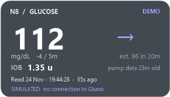

# N8 Glucose Overlay

A small native Windows 11 application displaying Gluroo Global Connect glucose readings over your desktop and borderless-windowed games. It includes a transparent, always-on-top, click-through overlay, tray controls, trend arrows, change per 5 minutes, a 20-minute estimate, insulin on board (IOB), local measurement timestamps, continuously updated reading age, and visible stale/offline states.

[Download the latest Windows release](https://github.com/G8rarror/n8-glucose-overlay/releases/latest)



> **Secondary display only.** N8 shows data that may be minutes (glucose) or about an hour (pump data) old. It has no alarms and gives no treatment advice. Use the CGM, pump, or meter for every medical decision. N8 is an independent project, not affiliated with Gluroo, Dexcom, or Tandem.

## What you need

- A Windows 11 PC (Windows 10 with .NET Framework 4.8 should also work but is untested). Nothing else to install.
- A [Gluroo](https://gluroo.com) account receiving CGM readings (for example from a Dexcom G7), with **Gluroo Global Connect / Nightscout** access turned on.
- Optional, for the IOB row: pump data reaching Gluroo. See [docs/PUMP_DATA.md](docs/PUMP_DATA.md).

## Quick start

1. Download the **N8-Glucose-Overlay** ZIP from [Releases](https://github.com/G8rarror/n8-glucose-overlay/releases/latest) and extract it (right-click → **Extract All**).
2. Double-click **N8GlucoseOverlay.exe**. If Windows shows **"Windows protected your PC"**, click **More info → Run anyway** (see [Windows warning](#windows-warning)).
3. In Gluroo on your phone, find your Nightscout URL and **API Secret Token** (details below).
4. Paste both into N8's Settings window and click **Save & connect**.
5. Drag the overlay where you want it (`Ctrl+Alt+G` toggles move mode), then lock it. Run **Install.cmd** if you want a Start menu entry.

## Run

1. Extract the **N8-Glucose-Overlay** ZIP to a folder you can write to.
2. Double-click **N8GlucoseOverlay.exe**. No administrator rights are needed.
3. In Gluroo, open **Connections → DIY / Nightscout (Loop)** and generate or copy your Nightscout URL and credential. Some versions place this under Settings → Gluroo Global Connect Nightscout.
4. Paste the exact base URL, such as `https://your-id.ns.gluroo.com`, into Settings. Paste the **API Secret Token** with the plain format selected, or choose **API Secret Header (SHA-1)** and paste its 40-character value.
5. Select **Save & connect**. The first request starts within a second when permitted by the request cooldown. If Gluroo has readings, the overlay displays the latest one. If it is empty, confirm readings are reaching Gluroo on your phone.

The Windows 11 built-in .NET Framework 4.8/4.8.1 is used. No SDK, Node, Python, WebView, account registration, or separate hosting is required to run the release.

### Windows warning

The executable is not code-signed, so Windows SmartScreen may say **"Windows protected your PC"** the first time. Click **More info**, check the app name is `N8GlucoseOverlay.exe`, and click **Run anyway**. If you prefer, compare the ZIP against the `.sha256` file on the release page (`Get-FileHash .\N8-Glucose-Overlay-<version>.zip`), or review the source and [build it yourself](#build-from-source).

To try the layout without credentials, check **Offline demo** in Settings, or run:

```powershell
.\N8GlucoseOverlay.exe --demo
```

Demo readings are labeled **DEMO / SIMULATED** and make no network requests. Demo mode lasts only for the current session. To connect to Gluroo, uncheck demo and save your connection.

## Install (optional)

Portable mode works directly from the extracted folder. To add a Start menu entry, double-click **Install.cmd**. It copies the application into `%LOCALAPPDATA%\Programs\N8 Glucose Overlay`; it does not require elevation and does not start the app automatically.

For optional sign-in startup and a desktop shortcut, open PowerShell in the extracted release folder and run:

```powershell
powershell.exe -NoProfile -ExecutionPolicy Bypass -File .\Install.ps1 -StartWithWindows -DesktopShortcut
```

Then open **N8 Glucose Overlay** from Start. To update, exit the app from the tray, extract the new release, and run its installer. Existing settings are kept. To disable sign-in startup, remove **N8 Glucose Overlay** from the Startup folder (`Win+R` → `shell:startup`).

## Controls

| Action | Control |
| --- | --- |
| Open settings | Double-click tray icon, or right-click → Settings |
| Lock / move | `Ctrl+Alt+G`, or tray → click-through locked / move mode |
| Reposition | Switch to move mode and drag the panel, then lock it |
| Hide / show | `Ctrl+Alt+H`, or tray menu |
| Recover position | Tray → Move to primary display |
| Choose a monitor | Settings → Overlay → display preset → Top right |
| Exact position | Settings → Overlay → X/Y in virtual desktop pixels; negative coordinates supported |
| Refresh | Tray → Refresh when allowed; cooldowns still apply |
| Exit | Tray → Exit |

Look under the tray's hidden-icons chevron if you do not see N8. Settings includes size (75–200%), panel opacity (0–95%), mg/dL or mmol/L, stale threshold (5–30 minutes), and polling interval (120–900 seconds). Opacity **0%** leaves only the text visible. Position and display choices persist. Disconnected or invalid monitor positions are moved back onto a connected display. Windows DPI changes are handled as the overlay moves between displays. Shortcuts may be unavailable in restricted desktop sessions or if another app has registered them; use the tray controls in that case.

## Reading states

- **CURRENT** means the measurement is newer than your configured stale threshold; it does not guarantee real-time delivery. The reading's local date/time and age are displayed below it.
- **STALE** appears when the measurement reaches that threshold. The last known value remains visible with an amber treatment.
- **OFFLINE** indicates a failed connection while a retained reading may still be recent. Once old enough, **STALE** takes priority and the connection error remains on the status line.
- **WAITING** means no reading is available. Unknown trends display `?`, rather than assuming a flat trend.
- Failed requests and empty results keep the last reading and its original timestamp. Older results cannot replace a newer reading. Future timestamps more than two minutes ahead are rejected; smaller discrepancies say **Clock ahead**.
- **Delta** (for example `+6 / 5m`) is the change since the previous CGM reading, normalized to five minutes. It is hidden when there is no previous reading within ten minutes.
- **est. … in 20m** is a straight-line projection of the last 20 minutes of readings. It only knows past CGM values, not insulin, food, or exercise, so it cannot anticipate a turn. It is hidden when there are fewer than three contiguous readings, a gap over 7.5 minutes, a noisy or curving trace, or a stale reading. Values outside the CGM range display as `<40` / `>400`. It is an estimate, not an alert.

Polls follow the CGM's 5-minute cycle: the next request is sent about 5 minutes 15 seconds after the newest reading, so a new reading usually appears within a minute. If it is late, the app retries every two minutes (or your polling setting, if longer); with no data or signal loss it checks every 5 minutes. About 300-400 glucose requests per day. Repeated network failures back off to fifteen minutes. Incorrect credentials suspend polling until you enter a changed credential or URL. For 401/403, verify the URL and credential pair or regenerate the connection in Gluroo. HTTP 429 suspends requests until 00:00 UTC the following day; the budget is shared with your other GGC clients. Closing settings, refreshing, and restarting do not bypass the saved cooldown. See [API_COMPATIBILITY.md](API_COMPATIBILITY.md) for the verified contract and testing boundary.

## Privacy and scope

The app sends a read-only HTTPS request directly to your Gluroo account origin. It stores only the SHA-1 API header, encrypted with Windows DPAPI for the current user, in `%LOCALAPPDATA%\N8GlucoseOverlay\settings.json`. The plain token is not saved. The header itself is a usable credential, so treat it as a password. DPAPI protects stored credentials from other Windows users, not from malicious programs running as you. The URL and appearance preferences are stored normally; request timestamps are in `request-limits.json`. Readings remain in memory and are cleared on exit. No telemetry, glucose history, or request/response logs are created.

Use this as a **secondary display only**. It provides no alarms, treatment recommendations, or device control. Use your CGM, pump, or meter directly for medical decisions. GGC is an experimental service and may change or stop responding. N8 is an independent application and is not affiliated with Gluroo.

This is a desktop composited overlay. Exclusive-fullscreen games, secure desktop/UAC prompts, and games that restrict overlays can cover it. Use borderless-windowed mode. It does not inject into games or interact with anti-cheat systems. Specific game compatibility and mixed-DPI hardware have not been manually tested.

## Treatments check (optional, read-only)

Run this to find out whether pump data (boluses, Control-IQ basal changes) reaches Gluroo without anyone entering it by hand, and how far behind it runs. Exit the overlay from the tray first, then run:

```powershell
.\N8GlucoseOverlay.exe --treatments-check
```

It uses your saved connection, sends one GET request to Gluroo's documented treatments endpoint, and respects the overlay's two-minute interval and daily limit. It opens a report window and saves the report as `treatments-check.txt` in `%LOCALAPPDATA%\N8GlucoseOverlay`. The report lists record types, counts, record ages and signs of automatic delivery. It never shows dose or carb amounts or notes. Run it a few times on different days to see the typical delay. The overlay itself reads at most five treatment records, only for the pump-data age (see Insulin on board). `--preview` writes `treatments-check-sample.txt` and `.png`, built from mocked data, so you can see the format first.

## Insulin on board

The IOB row shows Gluroo's own insulin-on-board figure (`glurooIob` from `GET /api/v1/devicestatus.json?count=1`), fetched with a glucose poll at most every 10 minutes and hidden once 25 minutes old. It needs pump data in Gluroo; [docs/PUMP_DATA.md](docs/PUMP_DATA.md) explains how to get Tandem pump data there, either with Gluroo's built-in Tandem connection or with [tconnectsync](https://github.com/jwoglom/tconnectsync) and the helper scripts in [`tools/tconnectsync`](tools/tconnectsync). It is only as current as the pump data in Gluroo: Tandem's phone app uploads about hourly, so recent boluses may be missing. `pump data Xm old` shows that age, in amber after 75 minutes. On the PC running tconnectsync it is read locally from `%LOCALAPPDATA%\tconnectsync\sync.log`. On other PCs it is estimated from the newest pump basal or bolus in `GET /api/v1/treatments.json?count=5` and marked `~`; it can read older than the truth, never newer. The pump screen is the authoritative IOB.

## Troubleshooting

| Symptom | What to check |
| --- | --- |
| No overlay visible | Look for the N8 icon under the tray's hidden-icons chevron. Use tray → **Move to primary display**, or `Ctrl+Alt+H` in case it is hidden. |
| **WAITING**, or "check Gluroo URL" | Confirm readings appear in the Gluroo app. Check the URL is the base address only (`https://your-id.ns.gluroo.com`), with no path or token. |
| "Authentication failed · update credentials" | The URL and token must come from the same Gluroo connection. Paste the plain **API Secret Token** with the plain format selected, or the 40-character hex value with **SHA-1** selected. |
| **STALE** | Gluroo has no new reading. Check the phone running the CGM app has signal and is uploading. |
| **OFFLINE** | The PC cannot reach Gluroo. It retries automatically, backing off up to 15 minutes. |
| "Daily API limit · paused until 00:00 UTC" | Gluroo's daily request limit (shared by every app using your Gluroo account) was reached. Fewer PCs or a longer polling interval helps. |
| IOB row missing | Gluroo has no IOB yet (no pump data), or IOB has not refreshed in 25 minutes. See [docs/PUMP_DATA.md](docs/PUMP_DATA.md). |
| IOB shows 0.00 after a bolus | Pump uploads are about hourly; wait for the next one. If it stays 0, set **Rapid Acting** insulin in Gluroo's insulin settings. |
| "pump data age unknown" or amber age | No pump record found, or none in 75 minutes. Check the phone's Tandem app is running, and run `upload-gaps.ps1` if you use tconnectsync. |
| Hidden behind a game | Switch the game to borderless-windowed. Exclusive fullscreen covers every overlay. |
| "Windows protected your PC" | See [Windows warning](#windows-warning). |

## Consoles, Mac, and phones

N8 is Windows-only. Xbox, PlayStation, and Switch do not allow third-party overlays over games. You can still see N8 while playing console games by streaming the console to a Windows PC (the Xbox app or PS Remote Play) in a window, which puts N8 on top as with any PC game. On phones and watches, use the Gluroo and Dexcom apps directly.

## Contributing and feedback

Bug reports and ideas are welcome through [Issues](https://github.com/G8rarror/n8-glucose-overlay/issues). Please never post your Gluroo URL, token, Tandem login, or screenshots showing them. Pull requests should keep the app read-only and pass `package.cmd`. Licensed under the [MIT License](LICENSE).

## Uninstall

Exit N8 from the tray, then run from its installed folder:

```powershell
powershell.exe -NoProfile -ExecutionPolicy Bypass -File .\Uninstall.ps1
```

To also remove saved settings and credentials, append `-RemoveData`. Otherwise these are retained. For a portable copy, exit and delete the extracted folder; optionally delete `%LOCALAPPDATA%\N8GlucoseOverlay` to remove its saved configuration. Rotate credentials in Gluroo if you want to revoke API access.

## Build from source

From a Windows 11 checkout, run **build.cmd**. The compiler included with Windows .NET Framework builds `build\N8GlucoseOverlay.exe`; no package restore or third-party packages are required. `package.cmd` builds, verifies, and creates the release ZIP. These commands write only to the checkout's generated directories.

```powershell
.\build.cmd
# WinForms programs should be launched with -Wait when checking their exit code:
Start-Process .\build\N8GlucoseOverlay.exe -ArgumentList '--self-test --output artifacts' -Wait
Start-Process .\build\N8GlucoseOverlay.exe -ArgumentList '--smoke-test --output artifacts' -Wait
```

Self-tests use fake credentials, mocked HTTP responses, Windows encryption, and temporary profiles under the output folder. Smoke tests briefly show their own test windows and inspect native click-through, focus, topmost, and position behavior; they need an interactive Windows desktop. Neither contacts Gluroo. Reports are written to `artifacts\self-test.txt` and `artifacts\smoke-test.txt`. `--preview --output artifacts` renders the same overlay drawing code as PNGs for layout inspection. Tests do not read or modify your normal N8 profile.
